# 🌾 KrishiMitra AI — Exploratory Data Analysis (EDA) Report

*Generated on: 2026-11-01 23:05:27*

This document provides an exhaustive exploratory data analysis (EDA) across the three core machine learning datasets powering the KrishiMitra AI platform:

1. **Crop Pest & Disease Leaf Image Dataset** (Computer Vision — EfficientNet-B0)
2. **Crop Recommendation Soil & Climate Dataset** (Multi-Class Classification — Random Forest)
3. **Crop Yield Agricultural Productivity Dataset** (Regression — Random Forest Regressor)

---

## 🌿 1. Crop Pest & Disease Leaf Image Dataset

- **Total Identified Images**: 25,220
- **Total Diagnostic Classes**: 22
- **Healthy Samples**: 3,239 (12.8%)
- **Infected/Diseased Samples**: 21,981 (87.2%)
- **Crop Families**: Cashew, Cassava, Maize, Tomato

### Diagnostic Visualizations & Descriptions:

#### 📊 `01_disease_class_distribution.png`
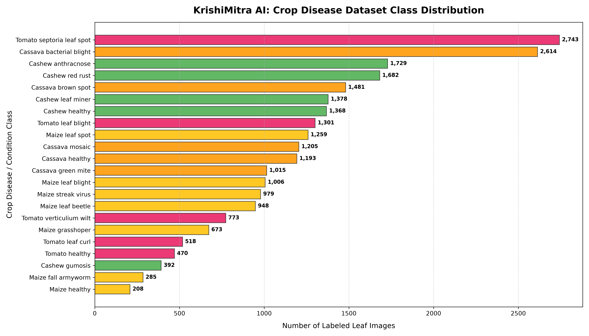

**Short Description & Agricultural Insight:**  
Horizontal bar chart showcasing the total sample count across all 22 disease classes. Highlights balanced vs. imbalanced target categories, validating class weighting in cross-entropy loss.

#### 📊 `02_disease_crop_breakdown.png`
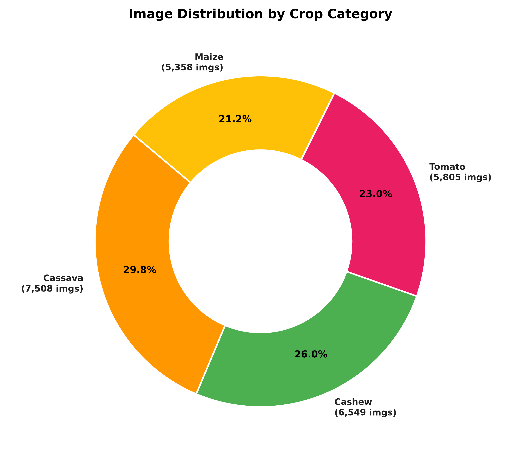

**Short Description & Agricultural Insight:**  
Donut chart summarizing the proportion of leaf images belonging to each crop family (Cashew, Cassava, Maize, Tomato). Illustrates multi-crop vision model generalizability.

#### 📊 `03_disease_healthy_vs_diseased.png`
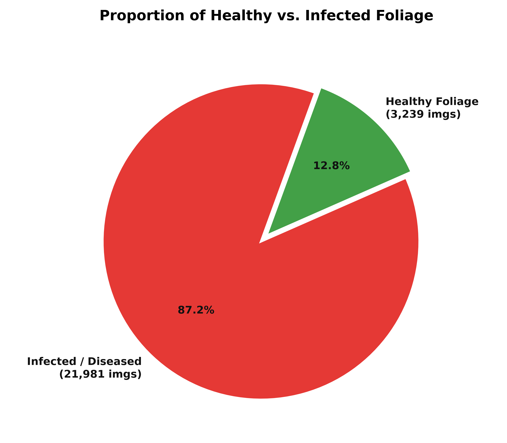

**Short Description & Agricultural Insight:**  
Pie chart contrasting healthy control leaves against pathological or pest-damaged specimens, ensuring the neural network learns positive disease markers rather than purely healthy plant morphology.

#### 📊 `04_disease_image_resolutions.png`
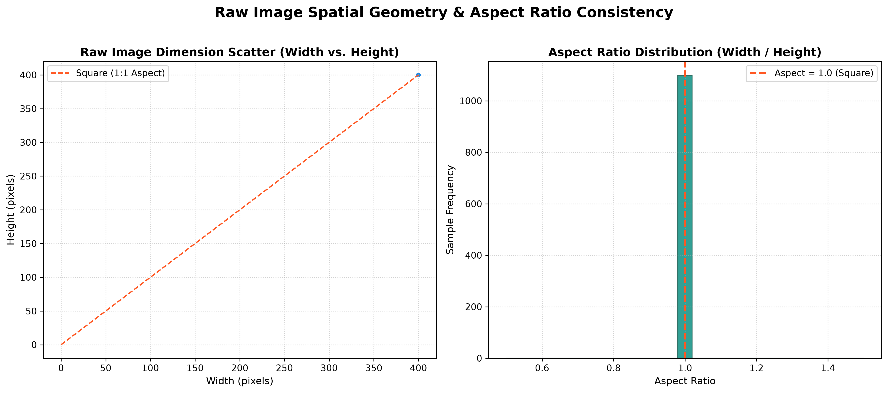

**Short Description & Agricultural Insight:**  
Dual scatter-and-histogram analysis of original image pixel dimensions and aspect ratios. Confirms spatial uniformity, demonstrating whether pre-training bicubic resize (224x224) induces distortion.

#### 📊 `05_disease_rgb_channel_profiles.png`
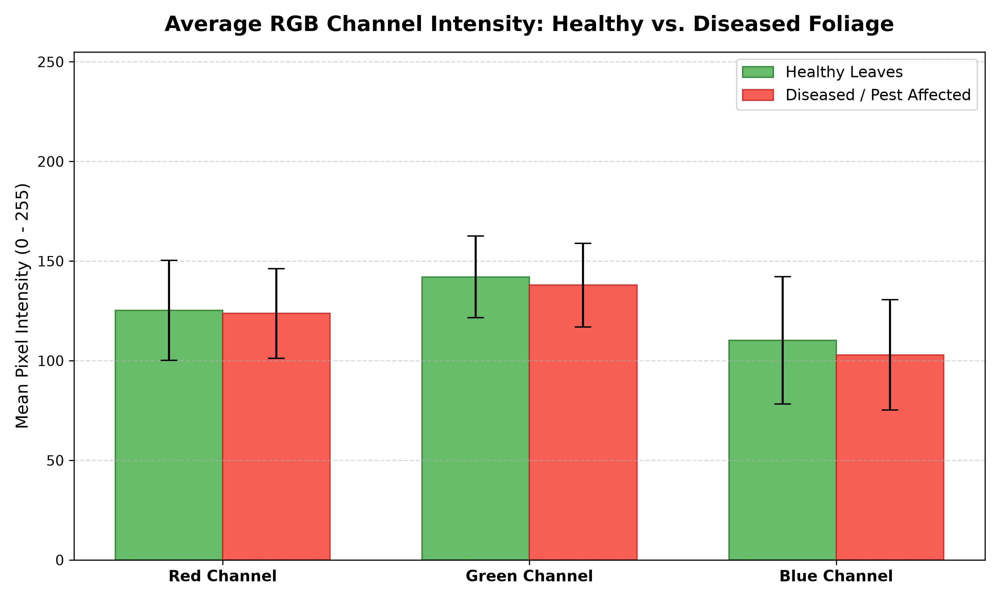

**Short Description & Agricultural Insight:**  
Grouped bar chart displaying comparative RGB chromatic profiles between healthy and diseased leaf sets. Quantifies necrotic and chlorotic pigment shifts (elevated Red and decreased Green reflectance in diseased tissue).

#### 📊 `06_disease_sample_montage.png`
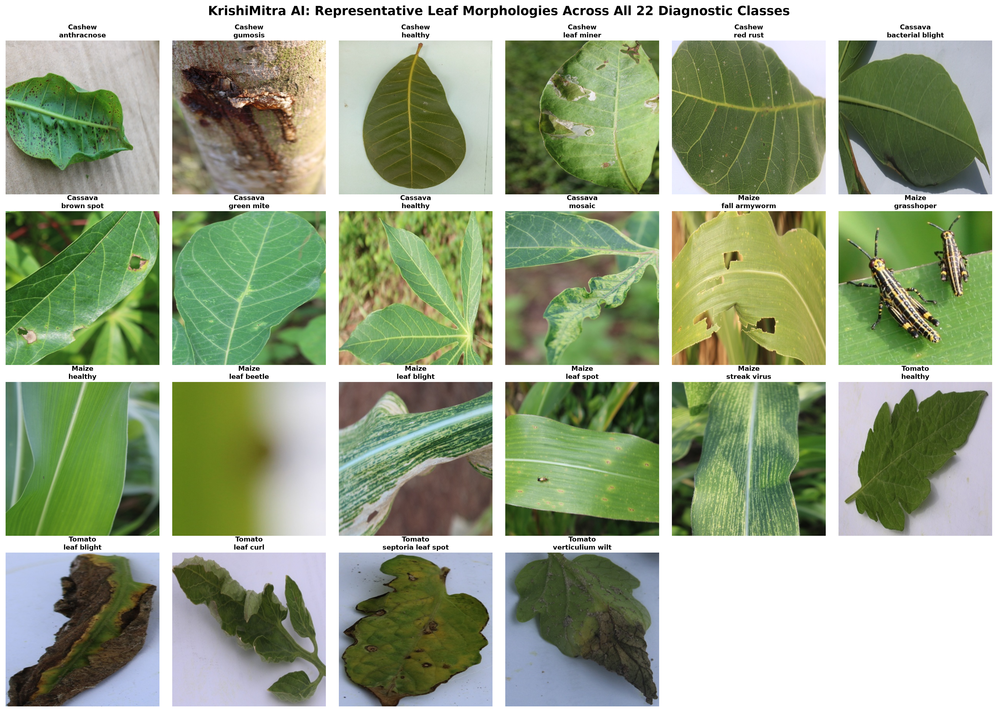

**Short Description & Agricultural Insight:**  
Photographic collage featuring an exemplar leaf image from every diagnostic class. Allows direct visual auditing of symptom severity, leaf pathology patterns, and lighting variations across classes.

---

## 🌾 2. Crop Recommendation Dataset (Soil & Climate)

- **Total Agricultural Observations**: 2,200
- **Unique Crop Varieties**: 22
- **Nutrient & Climatic Features**: N, P, K, temperature, humidity, ph, rainfall

### Agronomic Visualizations & Descriptions:

#### 📊 `01_crop_nutrient_npk_distribution.png`
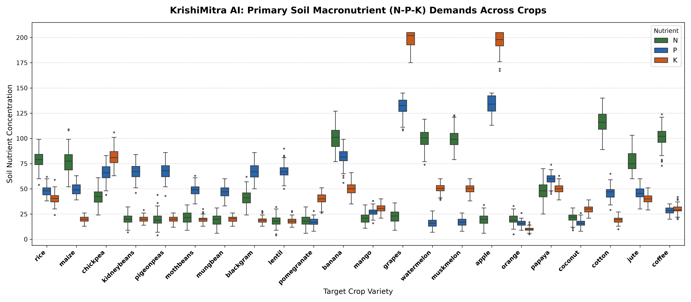

**Short Description & Agricultural Insight:**  
Grouped box plot comparing Nitrogen (N), Phosphorus (P), and Potassium (K) soil requirements across all 22 crop classes. Reveals distinct nutrient signatures, such as high potassium demands in grapes and apples, and high nitrogen in cotton and banana.

#### 📊 `02_crop_environmental_kde.png`
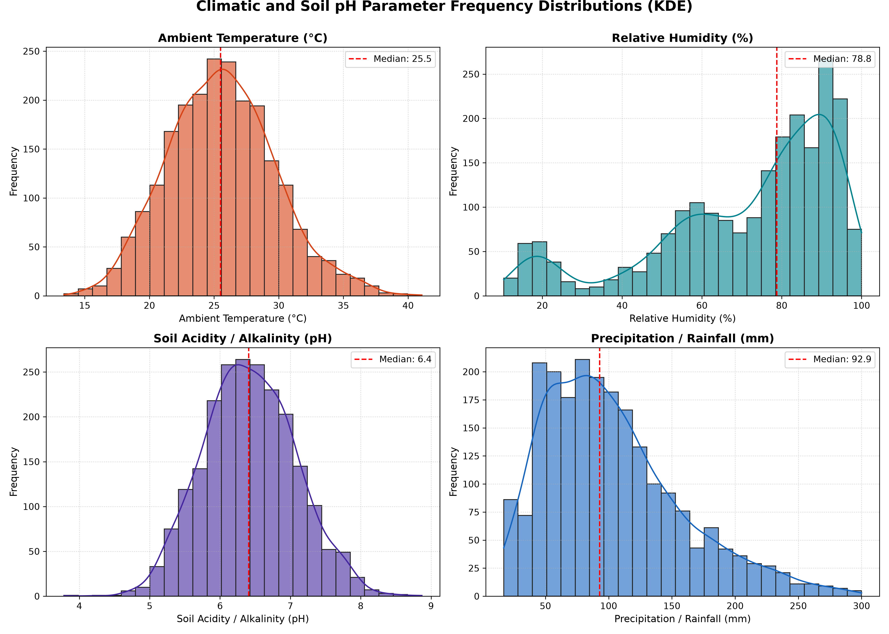

**Short Description & Agricultural Insight:**  
Four-panel histogram and Kernel Density Estimation (KDE) plot detailing temperature, humidity, pH, and rainfall distributions. Provides statistical baseline of agro-climatic boundaries required for viable crop cultivation.

#### 📊 `03_crop_feature_correlation_heatmap.png`
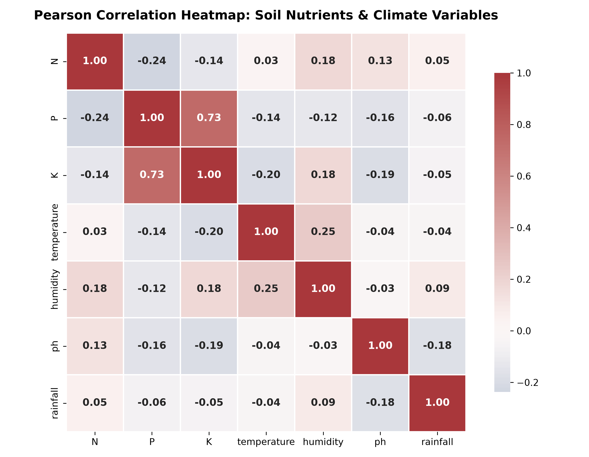

**Short Description & Agricultural Insight:**  
Correlation matrix highlighting linear relationships among agronomic indicators. Shows strong positive collinearity between Phosphorus (P) and Potassium (K), while rainfall and pH exhibit low mutual dependence.

#### 📊 `04_crop_soil_ph_ranges.png`
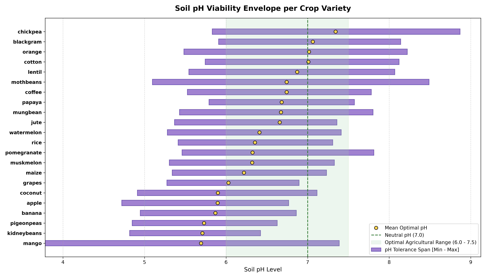

**Short Description & Agricultural Insight:**  
Horizontal range chart mapping the viable pH band (minimum, average, maximum) for all 22 crop species. Identifies crops suitable for alkaline soil (e.g., chickpea) versus mildly acidic conditions (e.g., kidneybeans, mango).

#### 📊 `05_crop_rainfall_vs_temperature_clusters.png`
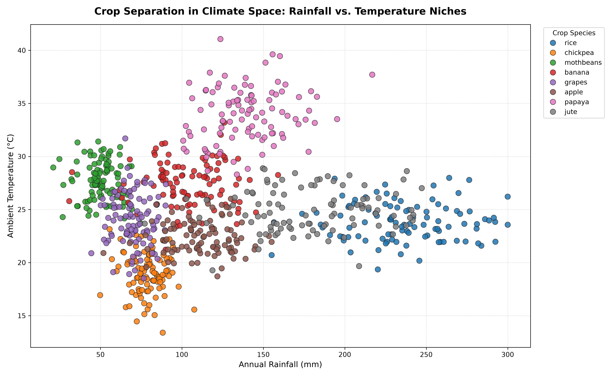

**Short Description & Agricultural Insight:**  
Bi-variate scatter visualization mapping crops against annual rainfall and temperature. Clearly segregates high-precipitation wetland crops (rice, jute > 180mm) from drought-resistant arid cultivars (chickpea, mothbeans < 90mm).

#### 📊 `06_crop_pairplot_soil_climate.png`
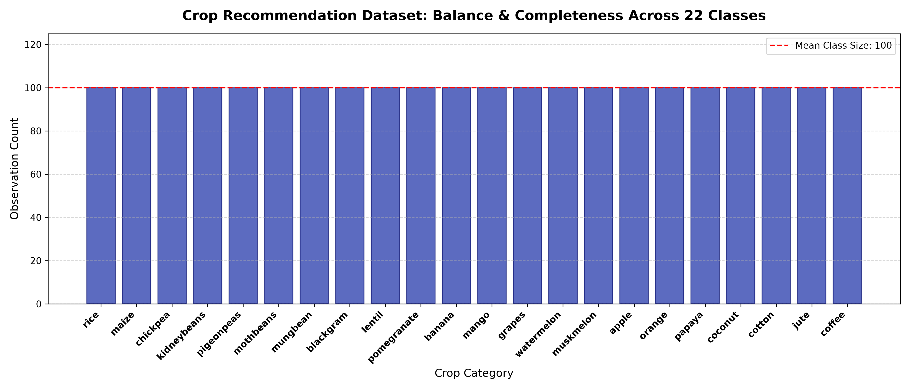

**Short Description & Agricultural Insight:**  
Uniform distribution check confirming exact class balance (100 observations per crop species, total 2,200). Verifies absence of majority-class bias during Random Forest multi-class model training.

---

## 📈 3. Crop Yield Prediction Dataset (Macro Productivity)

- **Total Historical Records**: 21,750
- **Covered Crops**: 52
- **Covered Indian States & UTs**: 29
- **Macro Features**: Year, Area, Annual_Rainfall, Fertilizer, Pesticide, Yield

### Productivity Visualizations & Descriptions:

#### 📊 `01_yield_distribution_by_crop.png`
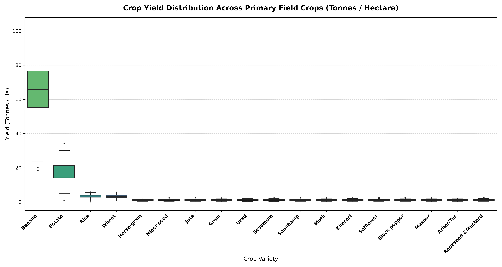

**Short Description & Agricultural Insight:**  
Box plot showing yield variance across the most frequently cultivated Indian field crops. Contrasts high-biomass perennials (Sugarcane, Banana > 50 t/ha) against cereals (Rice, Wheat ~ 3-4 t/ha) and pulses (~ 1 t/ha).

#### 📊 `02_yield_top_states_productivity.png`
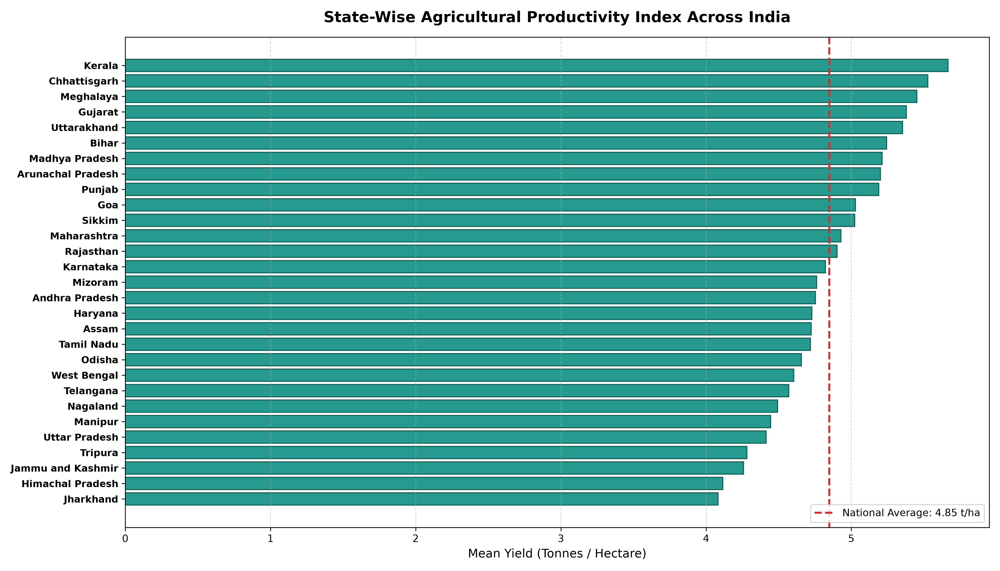

**Short Description & Agricultural Insight:**  
Horizontal ranking of mean agricultural productivity per hectare by State. Highlights regional irrigation and agro-climatic disparities, comparing agrarian breadbaskets with dryland states.

#### 📊 `03_yield_historical_trend.png`
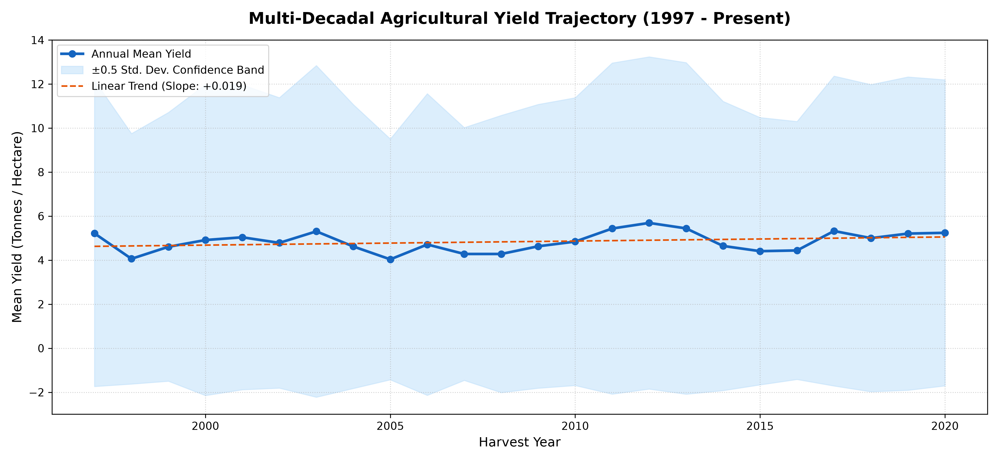

**Short Description & Agricultural Insight:**  
Time-series progression of annual harvest yield across Indian states from 1997 to benchmark era. Illustrates long-term technological adaptation, mechanization gains, and climate-induced yield volatility.

#### 📊 `04_yield_fertilizer_pesticide_impact.png`
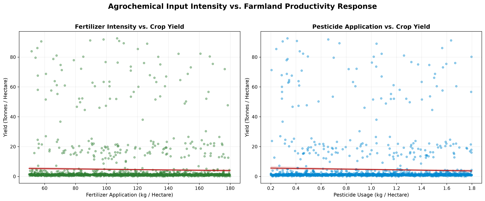

**Short Description & Agricultural Insight:**  
Dual scatter plots with regression trends evaluating marginal returns of chemical fertilizer and pesticide inputs per hectare. Depicts productivity gains alongside diminishing returns at high chemical saturation points.

#### 📊 `05_yield_seasonal_variation.png`
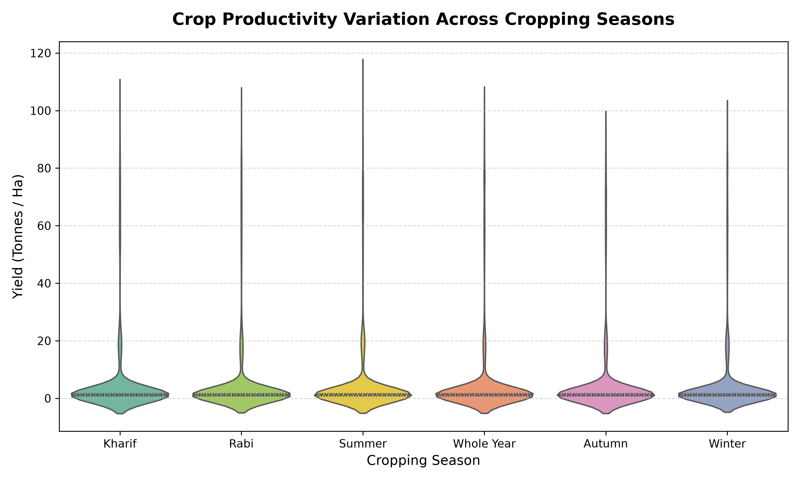

**Short Description & Agricultural Insight:**  
Violin distribution plot contrasting productivity across Indian cropping cycles (Monsoon Kharif vs. Winter Rabi vs. Summer Zaid). Reflects the impact of seasonal monsoon rainfall patterns on rainfed versus irrigated crops.

#### 📊 `06_yield_correlation_matrix.png`
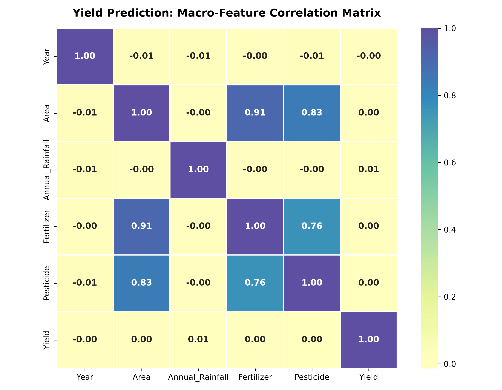

**Short Description & Agricultural Insight:**  
Correlation matrix among macro-scale features (Area, Rainfall, Agrochemicals, Yield). Validates strong collinearity between total Area and total fertilizer/pesticide tonnage, affirming feature engineering integrity.

---

### Summary of Artifacts Generated

- All high-resolution PNG figures (300 DPI) are saved in: `backend\ml\eda\outputs\figures`

- Full Markdown documentation report saved in: `EDA_REPORT.md`
